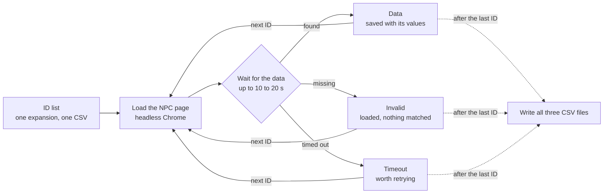

# WoWHead NPC Scraper Documentation

By Chris Raiz · [GitHub repository](https://github.com/ChrisRaiz/WoWHead-NPC-Scraper)

## Contents

- [Overview](#overview)
- [Requirements and installation](#requirements-and-installation)
- [Usage](#usage)
- [Output](#output)
- [How it works](#how-it-works)
- [Troubleshooting and limitations](#troubleshooting-and-limitations)

## Overview

WoWHead NPC Scraper collects data on World of Warcraft NPCs (non-player characters) from [Wowhead](https://www.wowhead.com)'s NPC database and saves it as structured CSV datasets ready for analysis or use in other applications. It covers 11 expansions, from the original game through The War Within.

For each NPC ID, four Python scripts gather four kinds of data:

| Script | Collects |
| --- | --- |
| `name_scraper.py` | The NPC's name |
| `stats_scraper.py` | Level, classification, creature type, patch added, health |
| `location_scraper.py` | The zones where the NPC appears |
| `image_scraper.py` | A screenshot URL |

Wowhead builds these pages with JavaScript after they load, so a simple HTTP request returns them without the data. The scripts use Selenium to run a real headless Chrome browser, which waits for each page to finish rendering before reading it.

The repo holds about 20,400 NPC IDs across all 11 expansions. Data has been scraped so far for five of them: Base (Classic), The Burning Crusade, Wrath of the Lich King, Cataclysm, and Mists of Pandaria.

## Requirements and installation

To run the scraper you need Python 3, Google Chrome, and the Python packages Selenium and pandas.

1. Clone the repo and move into it:

```bash
git clone https://github.com/ChrisRaiz/WoWHead-NPC-Scraper.git
cd WoWHead-NPC-Scraper
```

2. Create and activate a virtual environment:

```bash
python3 -m venv venv
source venv/bin/activate      # Windows: venv\Scripts\activate
```

3. Install the dependencies:

```bash
pip install selenium pandas
```

4. Set up ChromeDriver. Selenium 4.6 and later finds or downloads a ChromeDriver that matches your installed Chrome, so normally no extra step is needed. The original setup used ChromeDriver 114.0.5735.90 with the *Google Chrome for Testing.app* bundle placed in the project folder. That folder is already in `.gitignore`.

Run `deactivate` to leave the virtual environment when you're done.

## Usage

Each run scrapes one kind of data for one expansion. To choose the expansion, uncomment its `csv_path` block at the top of the script.

1. Open the script for the data you want, for example `scripts/stats_scraper.py`.
2. Comment out the active `csv_path` block (Base by default), then uncomment the block for the expansion you want.
3. Run the script from inside the `scripts` folder:

```bash
cd scripts
python3 stats_scraper.py
```

Each ID is printed as it's processed. The output files are written once, after every ID in the list has been visited. If you stop the script partway through, nothing is saved.

### Expansion codes

| Code | Expansion | IDs | Scraped |
| --- | --- | --- | --- |
| Base | World of Warcraft (Classic) | 993 | Yes |
| BC | The Burning Crusade | 977 | Yes |
| WOTLK | Wrath of the Lich King | 982 | Yes |
| CAT | Cataclysm | 982 | Yes |
| MOP | Mists of Pandaria | 750 | Yes |
| WOD | Warlords of Draenor | 904 | No |
| LEG | Legion | 927 | No |
| BFA | Battle for Azeroth | 901 | No |
| SL | Shadowlands | 917 | No |
| DRA | Dragonflight | 930 | No |
| TWW | The War Within | 952 | No |

### Building an ID list

The ID lists in `Expansions/<code>/ID/` were exported from Wowhead's NPC search using these filters:

1. **Level:** minimum 1. Set a maximum if the search returns more than 1,000 results.
2. **Added in patch:** 1.1.2 or later.
3. **Added in expansion:** the expansion you're collecting.
4. **Type:** one creature type at a time (Beast, Humanoid, Undead, and so on). Copy the IDs into `<code>_<Type>_IDs.csv`.

Combine the per-type files into `<code>_IDs.csv`, which is the file the scripts read. It has a single `ID` column. The [Wowpedia creature types page](https://wowpedia.fandom.com/wiki/Creature) lists every type.

## Output

Each run writes up to three CSV files into that expansion's folder. Every file is keyed by the NPC's Wowhead `ID`, so the four data files can be joined on that column.

| Folder | File | Contents |
| --- | --- | --- |
| `Data/` | `<code>_NPC_<Kind>.csv` | IDs scraped successfully, with their data |
| `Invalid/` | `<code>_<Kind>_Invalid_IDs.csv` | IDs whose page loaded but didn't contain the expected data |
| `Timeout/` | `<code>_<Kind>_Timeout_IDs.csv` | IDs whose page didn't load in time. These are worth running again. |

`<Kind>` is `Names`, `Stats`, `Locations`, or `Images`.

### Data fields

| File | Column | Example | Notes |
| --- | --- | --- | --- |
| Names | `Name` | C'Thun | From the page title |
| Stats | `Levels` | 60, or 58, 60 | A range is written as "low, high". `??` means a boss-level NPC. |
| Stats | `Level Range` | False | True when `Levels` is a range |
| Stats | `Classification` | Elite | Defaults to Normal |
| Stats | `Type` | Aberration | Creature type |
| Stats | `Patch` | 1.11.1 | Patch the NPC was added in |
| Stats | `Health` | 101,998,600 | Stored as text with commas |
| Locations | `Locations` | Temple of Ahn Qiraj | Comma-separated zones, letters only (apostrophes and digits are removed), or `Unknown` |
| Images | `Image` | `https://wow.zamimg.com/uploads/screenshots/small/271393.jpg` | URL of a small screenshot |

The stats scraper only saves an NPC if it found both a level and a health value. The locations file can list an NPC more than once when its page has several location headings, so deduplicate it before joining.

Sample rows from `Base/Data`:

```csv
ID,Levels,Level Range,Classification,Type,Patch,Health
15299,??,False,Elite,Aberration,1.11.1,"101,998,600"
```

## How it works

All four scripts follow the same loop: open each NPC's page, wait for one element to appear, and sort the ID into one of three result lists.



Results are held in memory and written to disk only once the last ID is done.

The scripts differ only in the element they wait for and how they clean it up:

| Script | Element it waits for | Cleanup |
| --- | --- | --- |
| `name_scraper.py` | The page `<title>` | Removes the " - NPC - World of Warcraft" suffix |
| `stats_scraper.py` | The `infobox-inner-table` quick-facts box | Reads the Level, Classification, Type, Added in patch, and Health lines with regular expressions |
| `location_scraper.py` | The `og:description` meta tag, then `#locations`, then `heading-size-2` headings | Records `Unknown` when the page says so. Keeps only letters and commas. |
| `image_scraper.py` | `` tags with class `border` served from `wow.zamimg.com` | Saves the first match's URL |

If Wowhead redirects an NPC to another game version's database, `location_scraper.py` reloads the standard retail URL. All four scripts load pages at `https://www.wowhead.com/npc=<ID>`.

## Troubleshooting and limitations

| Problem | Cause | Fix |
| --- | --- | --- |
| Many IDs end up in `Timeout/` | A slow connection, or Wowhead throttling repeated requests | Run the script again on just the timed-out IDs (see below). |
| A script crashes partway through and saves nothing | Output is written only after the loop finishes. `name_scraper.py` also has its `WebDriverException` handling commented out, so one browser error ends the run. | Restore the commented `try`/`except` in `name_scraper.py`. Split very large ID lists into smaller runs. |
| Shadowlands output fails or lands in the wrong folder | The SL `csv_path` blocks leave `SL/` out of the Timeout, Invalid, and Data paths | Change `./../Expansions/Timeout/...` to `./../Expansions/SL/Timeout/...`, and the same for Invalid and Data. |
| `FileNotFoundError` on startup | The script was run from outside `scripts/`, or the expansion's folder doesn't exist yet | Run it from `scripts/`. Create the `Data`, `Invalid`, and `Timeout` folders for expansions that only have an `ID` folder. |
| Every ID comes back invalid | Wowhead changed its page layout, so the selectors no longer match | Update the selectors in the script (see [How it works](#how-it-works)). |
| Chrome or ChromeDriver version error | The driver doesn't match the installed Chrome | Upgrade Selenium to 4.6 or later so it manages the driver itself. |

**Retrying timed-out IDs:** point `csv_path[0]` at the Timeout file, which has the same `ID` column. Rename or back up the existing `Data/` file first: each run overwrites its output files instead of adding to them.

**Speed:** pages are loaded one at a time. Each wait allows 10 to 20 seconds, so a run of about 1,000 IDs can take hours. The scripts don't pause between requests. Keep runs reasonable so they don't put a heavy load on Wowhead.
